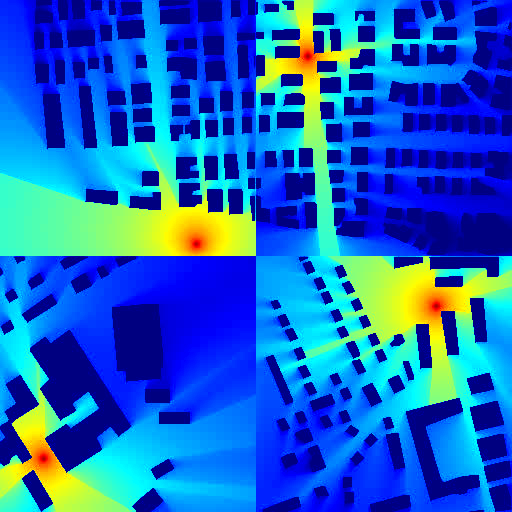

# TimeRadioMap

**Time-Series Radio Map Generation and Dataset Construction**

TimeRadioMap is a time-series radio map dataset for studying temporal generalization and controllable radio environment modeling. It contains sequences of radio maps generated over continuous time steps while conditioning on road-level dynamics.

## Dataset at a glance

| Property | Description |
| --- | --- |
| Number of sequences | 8,398 |
| Frames per sequence | 150 |
| Duration per sequence | Approximately 30 seconds |
| Frame rate | 5 frames per second |
| Spatial resolution | 256 × 256 pixels |
| Building layouts | 701 layouts and their corresponding road maps |
| Total radio maps | 1,259,700 (approximately 1.26 million) |

The building and road-map data corresponding to these layouts can be found in the [RadioMapSeer Dataset](https://radiomapseer.github.io/), introduced by Yapar et al. (2022). Radio maps are generated with [ControlRadio](https://github.com/AkonLau/ControlRadio), which conditions on road maps at successive time steps to produce temporally coherent outputs without rerunning physical simulation for every frame.

### Why a time-series dataset?

Radio map datasets are commonly used to study spatial estimation for a fixed scene. In a dynamic environment, however, road-level changes can make the radio environment evolve over time. TimeRadioMap provides temporally ordered maps so that methods can be studied not only on individual frames, but also on how their outputs change across a sequence.

The dataset is intended to support research such as:

- **Temporal reconstruction and prediction:** estimate or predict radio maps across successive time steps.
- **Temporal consistency:** study whether generated or reconstructed maps evolve coherently rather than changing erratically between frames.
- **Controllable environment modeling:** investigate the effect of time-varying road-map conditions on radio-map generation.
- **Layout generalization:** compare results on layouts observed during training with results on unseen test layouts.

These are potential research directions enabled by the data, not prescribed evaluation protocols. Please refer to the associated work for details about its experimental setup.

### Generation and reported runtime

TimeRadioMap is generated by conditioning ControlRadio on road maps at successive time steps. The framework uses the learned relationship between environmental layouts, road-level dynamics, and radio maps to produce temporally coherent sequences without running a new physical simulation for every frame.

The reported generation time for approximately 1.26 million radio maps is about **8 hours** on a single platform equipped with **8 NVIDIA GeForce RTX 4090 GPUs**. This figure describes the reported dataset-generation run; it should be considered alongside the offline supervision and model-training costs. After those offline costs, the paper reports substantially lower per-map online latency than repeated ray tracing.

### Visual preview

The animation below is a looping preview assembled from four sample videos processed with both filtering and duplicate-frame interpolation. Each panel plays the first 12 seconds of its sample forward and then in reverse; the full loop is 23.6 seconds at 5 fps. The preview uses Jet colors. Panels are ordered left to right, then top to bottom:

1. `0_1.avi` — layout 0, observed during training
2. `1_1.avi` — layout 1, observed during training
3. `600_1.avi` — layout 600, unseen test layout
4. `601_1.avi` — layout 601, unseen test layout

Each panel shows a portion of its original 150-frame, 30-second sequence.

<p align="center">
  
</p>

The individual sample videos are also available below:

| Layout | Split | Sample videos |
| --- | --- | --- |
| 0 | Training layout | [0_1.avi](examples/0_1.avi) |
| 1 | Training layout | [1_1.avi](examples/1_1.avi) |
| 600 | Unseen test layout | [600_1.avi](examples/600_1.avi) |
| 601 | Unseen test layout | [601_1.avi](examples/601_1.avi) |

Road maps 0 and 1 use layouts observed during training; road maps 600 and 601 use unseen test layouts. The examples illustrate the reported ability to maintain spatial coherence and temporal continuity across both groups.

### Video frame processing

[`video_frame_tools.py`](video_frame_tools.py) combines both video-processing operations in one command-line tool. It supports a single video file or recursively scans a directory, preserves the input frame count and rate, and writes to a separate output path by default.

The tool requires Python, OpenCV, and NumPy:

```bash
pip install opencv-python numpy
```

**Filter sudden brightest-point jumps.** For each frame, the script finds the brightest pixel in grayscale and computes the Euclidean distance between adjacent frames. If the distance is greater than 5 pixels, it replaces the unstable frame with a neighboring stable frame. Set a different limit with `--max-distance`:

```bash
python video_frame_tools.py filter examples --output examples_filtered --max-distance 5
```

The previous `-t` and `--threshold` options remain aliases for `--max-distance`.

The scan direction adapts to unstable runs at the clip boundaries. If the first three or more adjacent-frame transitions are unstable, filtering runs backward from the end. If both the first and last three or more transitions are unstable, it starts at the middle and filters outward toward both ends. Otherwise, it runs forward from the beginning. Boundary runs are detected using the original brightest-point positions. To assess both ends, the script buffers one video's decoded frames in memory before writing the result.

**Interpolate duplicate frames.** If a decoded frame is pixel-for-pixel identical to its preceding frame, it replaces the repeated frame with a 50/50 pixel-wise blend of the preceding and following frames. A repeated final frame has no following frame to use, so it is left unchanged and reported.

```bash
python video_frame_tools.py interpolate examples_filtered --output examples_interpolated
```

**Run both operations in sequence.** The `both` mode filters brightest-point jumps first, then interpolates duplicate frames from the filtered stream, without creating an intermediate video:

```bash
python video_frame_tools.py both examples --output examples_processed --max-distance 5
```

Each operation can also be run on a single video:

```bash
python video_frame_tools.py filter examples/0_0.avi --output 0_0_filtered.avi
python video_frame_tools.py interpolate examples_filtered/0_0.avi --output 0_0_interpolated.avi
python video_frame_tools.py both examples/0_0.avi --output 0_0_processed.avi
```

The original videos are not modified, and existing outputs are not overwritten unless `--overwrite` is specified. Supported formats include AVI, MP4, MOV, MKV, and WebM. If the default output codec is unavailable, choose one with `--fourcc`, for example `--fourcc MJPG`.

### Dataset access

The videos in this repository are **sample previews**, not the complete dataset. The complete dataset will be shared through a cloud drive in a future release. If you need access earlier, please contact the author by email. Since no email address is currently listed in this repository, you can reach the author through the [AkonLau GitHub profile](https://github.com/AkonLau) to request contact details and access information.

### Related work

- [ControlRadio: Prompt-Driven Controllable Diffusion for Cross-Modal Radio Map Generation](https://github.com/AkonLau/ControlRadio) — the generation framework and associated paper.
- [RadioMapSeer Dataset](https://radiomapseer.github.io/) — the source for corresponding building and road-map data; see the ControlRadio paper for the full Yapar et al. (2022) reference.

## 中文介绍

**TimeRadioMap** 是一个面向时序无线电地图研究的数据集，可用于探索时间泛化和可控无线电环境建模。数据集通过连续时间步的道路级动态条件生成无线电地图序列，让研究者能够分析地图随时间的变化，而不仅仅是评估单帧结果。

### 数据集概况

| 属性 | 说明 |
| --- | --- |
| 序列数量 | 8,398 个 |
| 每个序列的帧数 | 150 帧 |
| 每个序列的时长 | 约 30 秒 |
| 帧率 | 每秒 5 帧 |
| 空间分辨率 | 256 × 256 像素 |
| 建筑布局 | 701 个布局及其对应的道路地图 |
| 无线电地图总数 | 1,259,700 张（约 126 万张） |

这些布局对应的建筑物数据和道路数据可以在 [RadioMapSeer Dataset](https://radiomapseer.github.io/) 中找到；该数据集由 Yapar 等人（2022）介绍。我们使用 [ControlRadio](https://github.com/AkonLau/ControlRadio)，根据连续时间步的道路地图生成具有时间连贯性的无线电地图，而无需对每一帧都重新运行物理仿真。

### 数据集用途

传统无线电地图研究通常关注固定场景下的空间估计；在动态环境中，道路级变化会使无线电环境随时间演化。TimeRadioMap 提供按时间排列的地图序列，便于研究模型对时序变化的重建、预测与建模能力。数据可支持以下研究方向：

- **时序重建与预测：** 对连续时间步的无线电地图进行估计或预测。
- **时间一致性分析：** 研究生成或重建的地图能否随时间平滑、连贯地变化。
- **可控环境建模：** 分析时变道路地图条件对无线电地图生成的影响。
- **布局泛化：** 比较模型在训练中出现过的布局和未见测试布局上的表现。

以上是数据集可支持的研究方向，并非预设的评测协议；具体实验设置请参阅相关论文。

### 生成方式与报告耗时

TimeRadioMap 使用 ControlRadio，以连续时间步的道路地图作为条件生成无线电地图序列。模型学习环境布局、道路动态和无线电地图之间的关系，从而在不对每帧重复运行物理仿真的情况下生成具有时间连贯性的结果。

论文报告，生成约 **126 万张无线电地图**耗时约 **8 小时**，使用单台配备 **8 张 NVIDIA GeForce RTX 4090 GPU** 的平台。该时间是报告的数据集生成耗时，应与离线监督和模型训练成本一并理解。论文指出，在支付这些离线成本后，相较于重复射线追踪，该方法能够显著降低在线生成单张地图的延迟。

### 可视化样例

下方循环动画由四段经过突变帧筛选和重复帧插值处理的样例视频合成。每个画面取样例的前 12 秒，先正序播放再逆序播放；整段动画时长为 23.6 秒，帧率为 5 fps，并采用 Jet 配色。画面从左至右、从上至下依次为：

1. `0_1.avi`：布局 0，训练中出现过的布局
2. `1_1.avi`：布局 1，训练中出现过的布局
3. `600_1.avi`：布局 600，未见过的测试布局
4. `601_1.avi`：布局 601，未见过的测试布局

每个画面均截取自原始的 150 帧、约 30 秒序列。

<p align="center">
  
</p>

各布局的完整样例视频见上方英文部分的视频表格。布局 0 和 1 在训练中出现过，布局 600 和 601 是未见测试布局；这些样例展示了论文报告的模型在两类布局上的空间连贯性和时间连续性。

### 视频帧处理工具

仓库中的 [`video_frame_tools.py`](video_frame_tools.py) 将突变帧筛选和重复帧插值合并为一个脚本。支持处理单个视频或递归扫描目录，并保持输入视频的帧数和帧率；默认写入单独的输出路径。

工具依赖 Python、OpenCV 和 NumPy：

```bash
pip install opencv-python numpy
```

**筛选最亮点突变帧。** 脚本逐帧定位灰度图中的最亮像素，并计算相邻帧最亮点之间的欧氏距离；若距离**大于 5 个像素**，就用相邻稳定帧替换突变帧。可通过 `--max-distance` 调整距离上限：

```bash
python video_frame_tools.py filter examples --output examples_filtered --max-distance 5
```

旧参数 `-t` 和 `--threshold` 仍可作为 `--max-distance` 的别名使用。

筛选方向会根据视频首尾的不稳定情况自动选择：若开头连续 3 个或以上相邻帧跳变超阈值，则从视频末尾反向处理；若开头和结尾都存在至少 3 个连续超阈值跳变，则从视频中间向两端处理；其他情况从头向后处理。首尾连续段根据原始视频中最亮点的位置变化判定。为检查首尾并确定方向，脚本会先将单个视频的解码帧缓存到内存。

**插值重复帧。** 若解码后某帧与前一帧逐像素完全相同，脚本会使用前一帧和后一帧进行 **50/50 像素插值**，替换这张重复帧。视频末尾的重复帧没有后一帧可供插值，因此保持原样并在结果中报告。

```bash
python video_frame_tools.py interpolate examples_filtered --output examples_interpolated
```

**依次执行两种操作。** `both` 模式会先筛选最亮点突变帧，再对筛选结果中的重复帧进行插值；整个过程在一次视频扫描中完成，不生成中间视频：

```bash
python video_frame_tools.py both examples --output examples_processed --max-distance 5
```

每种操作也都可以处理单个视频：

```bash
python video_frame_tools.py filter examples/0_0.avi --output 0_0_filtered.avi
python video_frame_tools.py interpolate examples_filtered/0_0.avi --output 0_0_interpolated.avi
python video_frame_tools.py both examples/0_0.avi --output 0_0_processed.avi
```

脚本不会修改原视频；默认不会覆盖已有输出，除非指定 `--overwrite`。支持 AVI、MP4、MOV、MKV、WebM 等常见格式。如果默认输出编码器不可用，可以使用 `--fourcc` 指定编码，例如 `--fourcc MJPG`。

### 数据集获取

本仓库目前提供的是**部分样例视频**，并非完整数据集。完整数据集后续将在云盘分享。如需提前获取，可通过邮箱联系作者。由于仓库目前尚未公布邮箱地址，也可以通过 [AkonLau 的 GitHub 主页](https://github.com/AkonLau)联系作者，以获取邮箱和数据集访问方式。

### 相关工作

- [ControlRadio：Prompt-Driven Controllable Diffusion for Cross-Modal Radio Map Generation](https://github.com/AkonLau/ControlRadio)：TimeRadioMap 所使用的生成框架及相关论文。
- 对应的建筑物数据和道路数据可在 [RadioMapSeer Dataset](https://radiomapseer.github.io/) 中找到；Yapar 等人（2022）的完整引用信息请参阅 ControlRadio 论文。
